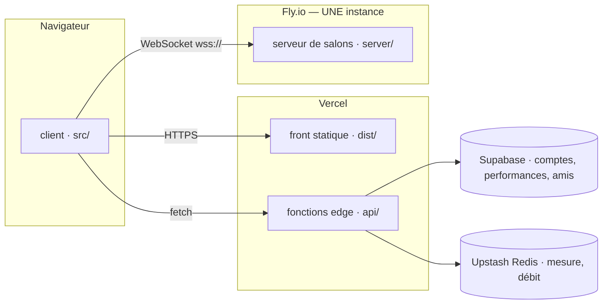
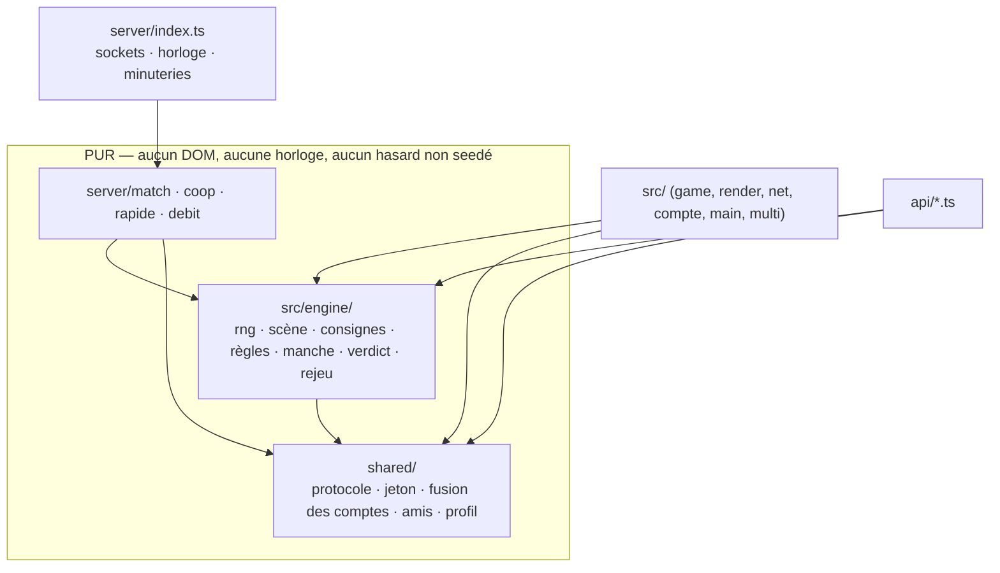
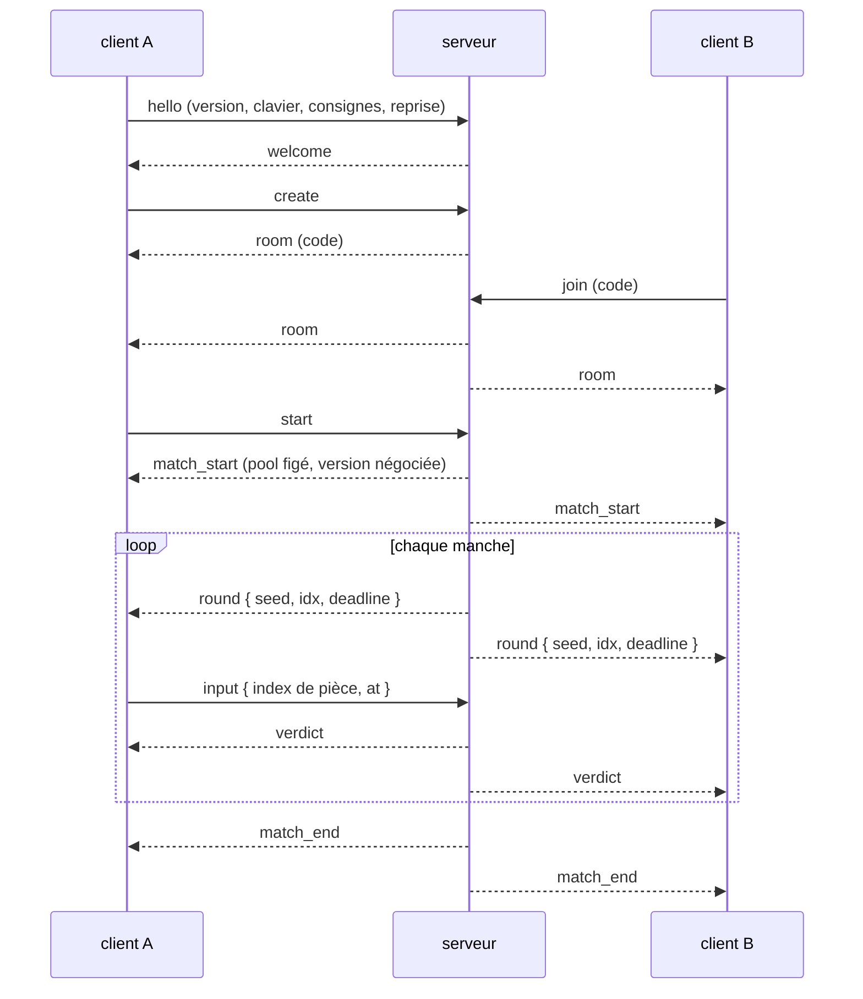
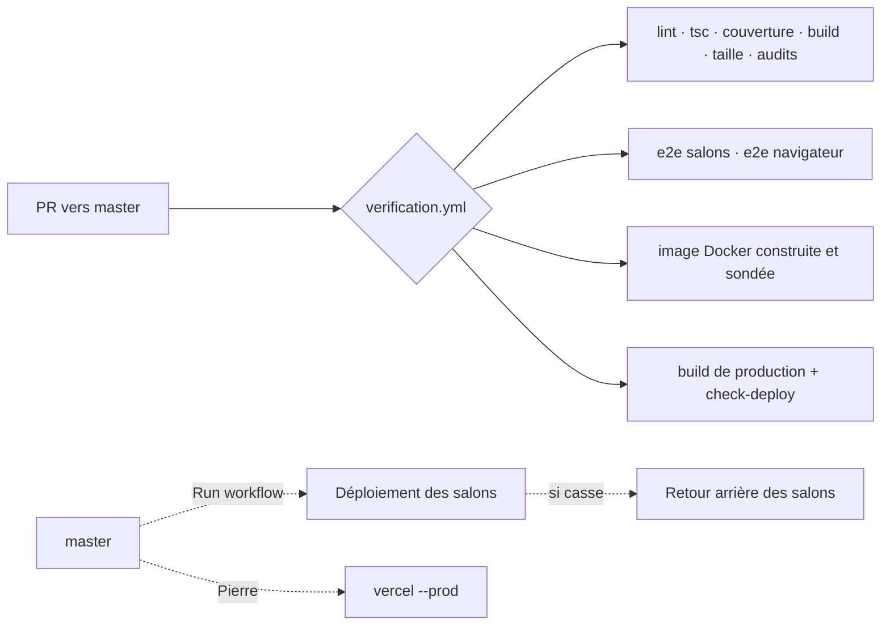

# Architecture

Vue d'ensemble, pour quelqu'un qui arrive. Les **pourquoi** sont dans les
[ADR](adr/README.md) ; les pièges payés et l'historique des décisions dans
[`CLAUDE.md`](../CLAUDE.md). Ce document dit **ce qui existe, où, et quelle
frontière tient quoi**.

---

## 1. Trois déploiements, un dépôt

| | où | quoi | cycle de vie |
|---|---|---|---|
| **Front** | Vercel (statique) | `index.html` + `src/`, construit par Vite | `vercel --prod` |
| **Edge** | Vercel (fonctions) | `api/*.ts` : mesure, comptes, performances, amis | avec le front |
| **Salons** | Fly.io, **une seule machine** | `server/` : salons en mémoire, WebSocket | flux « Déploiement des salons » |

Le front et les salons se déploient **séparément** ; tout ce qu'ils se disent
est donc **négocié** (ADR [0008](adr/0008-negociation-sur-le-fil-et-ordre-de-deploiement.md)),
et le serveur part **en premier**.

## 2. Les couches, et la frontière qui tient tout

**La règle** : une flèche ne remonte jamais vers le haut. Le moteur ne
connaît ni le DOM, ni l'heure, ni le réseau ; c'est ce qui permet :

- au **serveur edge** de *rejouer* un run du jour avec le même code que le
  client (`verifyRun`, `src/engine/verify.ts`) — ADR [0002](adr/0002-moteur-pur-et-rejeu-serveur.md) ;
- au **multijoueur** de reconstruire chaque manche depuis `{ seed, idx }`
  sans transmettre de scène — ADR [0003](adr/0003-netcode-graine-et-index.md).

**Elle est tenue par des tests, pas par la relecture** :

| test | ce qu'il refuse |
|---|---|
| `tests/architecture.test.ts` | un import hors de sa couche ; `Math.random`, `Date.now`, minuterie, API du navigateur, `fetch` dans une couche pure |
| `tests/invariants-compte.test.ts` | le moteur ou la logique de match qui dépendraient du compte (ADR [0005](adr/0005-comptes-optionnels-et-fusion-monotone.md)) |
| `tests/image.test.ts` | un import du serveur vers un fichier que le Dockerfile ne copie pas |

## 3. Le client (`src/`)

| dossier | rôle |
|---|---|
| `engine/` | le jeu en tant que règles : manches, consignes, règles uniques, verdicts, difficulté, rejeu |
| `game/` | orchestration solo : `Session`, run du jour, parcours, carnet, quêtes, boutique |
| `render/` | dessin (canvas `scene.ts`) et décisions d'affichage PURES et testées (`layout`, `plate`, `seat`, `jour`, `but`, `exploit`…) |
| `net/` | client WebSocket, horloge serveur, calendrier de reprise — sans DOM |
| `compte/` | jeton local, revendication des runs, file d'envoi persistée |
| `analytics/` | file de mesure groupée, `sendBeacon` |
| `audio/` | sons synthétisés (WebAudio), aucun fichier |
| `main.ts`, `multi.ts` | l'application : écrans, boucle de jeu unique, salons |

Pas de framework : le DOM est écrit par `index.html` et piloté par `main.ts`.
**Une seule boucle** (`requestAnimationFrame` dans `main.ts`) : tout ce qui
anime — jeu, décor, rebours — y passe, pour qu'un décor ne puisse jamais
affamer le jeu.

## 4. Le serveur de salons (`server/`)

- **Autorité sur le temps** : le serveur fixe les échéances ; les clients
  projettent leurs actions sur l'horloge serveur.
- **Aucune scène sur le fil** : chaque client reconstruit la manche avec
  `buildMultiRound(seed, idx, règle, pool)`. Client et serveur jugent la même
  action (CLAUDE.md §6 n°3).
- **Salons en mémoire, une instance** — ADR [0004](adr/0004-salons-en-memoire-instance-unique.md).
- **Défenses** : liste blanche d'origines (`origin.ts`), limites de débit
  (`debit.ts`), écouteur `error` sur chaque socket, minuteries gardées.

## 5. Les fonctions edge (`api/`)

| route | rôle |
|---|---|
| `collect` | mesure : événements en liste blanche, vers Upstash |
| `auth`, `authcb` | OAuth Google / Discord, jetons, renouvellement, révocation |
| `moi` | profil, fusion du carnet (union et maximum), suppression |
| `perf` | run du jour : soumis, **rejoué** par `verifyRun`, classé |
| `amis` | codes d'ami, demandes, cercle |

Les fichiers préfixés `_` ne sont pas routés : `_depot` (Supabase ou mémoire),
`_jeton`, `_debit`, `_corps`. L'ancien `_ranked` est retiré : il acceptait une
identité non vérifiée. Le podium passe par `perf`.

**Ce qui est opposable est rejoué** — ADR [0006](adr/0006-opposable-signifie-rejoue.md).
Les jetons sont vérifiés de deux façons, synchrone sur Fly et asynchrone sur
l'edge, avec le même noyau — ADR [0007](adr/0007-deux-hmac-synchrone-et-asynchrone.md).

## 6. Données

| où | quoi | qui écrit |
|---|---|---|
| `localStorage` | sauvegarde complète (carnet, réglages, records) | le client — le jeu ne dépend de rien d'autre |
| Supabase `utilisateur` | identité, apparence, **agrégats** (affirmations du client) | `api/moi` |
| Supabase `performance` | runs du jour **vérifiés** | `api/perf`, après rejeu |
| Supabase `lien_plateforme` | les comptes Google / Discord liés à un utilisateur | `api/auth` |
| Supabase `amitie`, `demande_ami` | le cercle (le code d'ami vit sur `utilisateur`) | `api/amis` |
| Upstash | événements de mesure (listes par jour, 40 jours), compteurs de débit | `api/collect`, `api/_debit` |

Migrations : `supabase/migrations/0001` à `0005`, à appliquer dans l'ordre.

## 7. Vérification et livraison

Détail des commandes : [README](../README.md) ; procédure : [`DEPLOIEMENT.md`](DEPLOIEMENT.md) ;
règles de contribution : [`CONTRIBUTING.md`](../CONTRIBUTING.md).

## 8. Ce que cette architecture ne sait pas faire

Écrit pour qu'on ne le découvre pas en production :

- **plusieurs instances de salons** — les salons vivent en mémoire ; en
  ajouter une coupe les joueurs en deux mondes (ADR 0004) ;
- **un déploiement sans perte** — un `fly deploy` ferme les salons en cours
  (proprement, en 1001, mais ils sont perdus) ;
- **une preuve d'humanité** — `verifyRun` prouve qu'un journal est
  *cohérent*, pas qu'un humain l'a produit : d'où un classement quotidien et
  d'amis, pas mondial et permanent (ADR 0006) ;
- **un client plus récent que son serveur** quand le protocole change sans
  négociation (ADR 0008).
